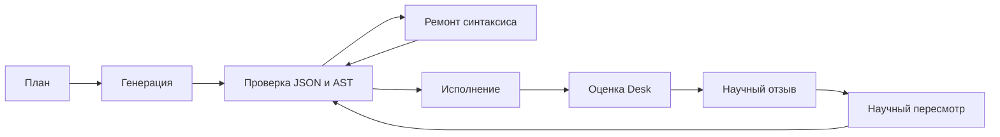

# Этап 3.2. Research Intelligence

Опорный коммит: `8a8b0e46d4645eb05a08cf69039e85fce5c8c85d`. SHA этого этапа равен `git rev-parse HEAD` после локального коммита. Push не выполнялся.

Подтверждённой закономерности нет. Единственный живой счёт относится к синтетическому ряду 2019–2020, а не к цене Bitcoin. Qwen не назначает `supported` и не создаёт Validated Law. Новый поиск PySR не запускался. Данные с 2022 года не открывались. 2021 год в адаптацию формулы не входил.

## 1. Модули

Новые:

- `grammar_contract.py` — грамматика, JSON Schema и заранее заданный бюджет.
- `research_ports.py` — интерфейсы планировщика, генератора, ремонта и пересмотра. Клиент передаётся снаружи.
- `research_plan.py` — проверка плана.
- `schema_generation.py` — одна формула внутри уже принятого плана.
- `syntax_repair.py` — ремонт JSON и математического синтаксиса, сравнение семантики.
- `scientific_feedback.py` — отзыв Verification Desk.
- `scientific_revision.py` — новая версия с `parent_hypothesis_id`.
- `memory_retrieval.py` — короткий отбор прошлых записей как данных.
- `intelligence_log.py` — журнал попыток при `commit=True`.
- `research_intelligence.py` — цикл v2.

Изменён `formula.py`: добавлен `parse_expression` для сравнения структуры. Корень вероятности по-прежнему обязан быть `sigmoid`. `parse_formula` это требование сохраняет. `eval` и `exec` не используются.

Старые отчёты и сохранённые результаты не менялись.

## 2. Схема цикла

Бюджет зафиксирован до просмотра метрик: 1 план, 5 обращений на генерацию и ремонт, общий потолок 6, 2 синтаксических ремонта, 2 научных пересмотра, 3 уникальные формулы на оценке, один клиент, последовательные вызовы. По умолчанию dry-run.

Окна те же, что на этапе 3.1. Модель их не выбирает.

| Роль | Даты |
| --- | --- |
| Обучение контрольной логистики | решения 2019 года, метка созрела не позже 2019-12-31 |
| Общий тест | решения с 2020-07-01, метка созрела не позже 2020-12-31 |
| Зазор | не меньше горизонта |
| 2021 | DEV_ONLY, в подбор не входит |
| С 2022-01-01 | набор отклоняется |

Четыре флага разделены: `syntactic_success`, `execution_success`, `development_improvement`, `independent_validation`. Последний в этом цикле остаётся ложным. Снижение Brier на внутреннем окне независимым подтверждением не становится.

## 3. Живой цикл Qwen

Модель `qwen3.5:4b`, digest `d8b0f5e9760cd1682034f292d7ef72ec46f432149be0df7574bf2d6e92e38c04`, 4.2B, Ollama 0.40.9. Температура 0, seed 1729, контекст 2048, ответ до 512 токенов, один HTTP-повтор не делался, `keep_alive` 0. Журнал и Research Memory не записывались.

Сначала один вызов плана остановил прогон: после ответа свободно было около 2.46 ГиБ при пороге 4 ГиБ, модель ещё не успела освободить память. Формула не считалась. В код добавлено ожидание выгрузки до 20 секунд между вызовами одной и той же модели. Второй экземпляр не запускался.

Полный прогон после этого: 6 обращений, 99.4 с. Пик процесса Python около 49 МБ. До прогона свободно было около 5.43 ГиБ. После него `ollama ps` пуст. План совпал с прерванным вызовом, потому что температура и seed те же. Этот план не подбирался по уже посчитанному Brier: на прерванном вызове счёта не было.

### План

Вопрос: «Какое сочетание из log_return, momentum_7 и volatility_30 лучше всего предсказывает направление следующего дня в условиях высокой волатильности?»

Это вопрос модели, не установленная связь. Горизонт 1 день. Условие `high_volatility`. Способ оценки зафиксирован строкой `fixed_internal_brier_log_loss`. В плане перечислены все разрешённые признаки. Предложенная словами связь: `sign(log_return * momentum_7 + tanh(volatility_30))`. Ограничение модели: синтетический ряд не даёт рыночного вывода, данные после 2021 года в запрос не входили.

### Синтаксический ремонт

| Шаг | Выражение | Итог |
| --- | --- | --- |
| Генерация | `sign(log_return * momentum_7 + tanh(volatility_30))` | Отказ: корень не `sigmoid`. Счёта нет. |
| Ремонт 1 | `sigmoid(sign(log_return * momentum_7 + tanh(volatility_30)))` | Корень добавлен. Это смена отображения score в вероятность, эквивалентность не доказана. Дополнительно `parent_hypothesis_id` не был пустым, поэтому формула ещё не исполнялась. |
| Ремонт 2 | та же формула с пустым родителем | JSON исправлен. Выражение относительно предыдущего ремонта не менялось. Формула допущена к счёту. |

Оба ремонта вошли в общий лимит двух. Научные пересмотры после этого уже не могли запросить новый ремонт.

### Исполненная формула

Одна формула дошла до оценки:

`sigmoid(sign(log_return * momentum_7 + tanh(volatility_30)))`

Внутреннее окно, горизонт 1 день, 182 решения, даты 2020-07-01 … 2020-12-29, зазор 183 дня. 2021 год пропущен. Подбор по 2021 году не выполнялся.

| Метрика | Значение |
| --- | --- |
| Brier формулы | 0.311005 |
| Log loss | 0.829745 |
| Brier константы 0.5 | 0.250000 |
| Brier прошлой частоты | 0.250652 |
| Brier логистики 2019 | 0.250644 |
| Разница с константой 0.5 | −0.061005 |
| Интервал разницы | −0.131435 … 0.009424 |

Точечная оценка хуже константы 0.5, хуже прошлой частоты и хуже логистики 2019 года. Интервал содержит ноль. Исход: `not_better_than_baseline`. `development_improvement` ложен. `independent_validation` ложен. Статус `not_confirmed`.

Второй формулы на тех же датах нет, сравнивать версии не с чем.

### Научный пересмотр

Оба пересмотра вернули текст без JSON-объекта. Лимит синтаксического ремонта уже был исчерпан, поэтому каждый пересмотр закончился статусом `syntax_unrepaired`. Новой формулы, Brier и сравнения с родителем нет. Модель не получила права объявить улучшение.

Итого полного прогона: 6 обращений к Qwen, 1 план, 3 запроса гипотез, 2 ремонта, 2 пересмотра, 1 формула на оценке. Вместе с прерванным планом до исправления ожидания за этап было 7 вызовов; счёт по ним один.

## 4. Тесты

Полный `pytest` на итоговом коде: **287 passed, 1 skipped**, 66.4 с. Maximum RSS прогона около 978 МБ.

Пропуск прежний: Optuna уже установлена. В прогон входит уже существовавший лёгкий тест PySR. Нового поиска не было. Qwen во время pytest не вызывалась.

Двадцать новых проверок закрывают JSON, ремонт JSON, отсутствующий корень `sigmoid`, границы грамматики, смену семантики, опасную функцию, будущие даты, план и отказ плана, разделение отзывов, Brier и log loss, дочернюю гипотезу, историю родителя, дубликаты, потолок вызовов, сохранение неудач, запрет закрытых дат, запрет Validated Law, недоступный Ollama и полный синтетический цикл.

## 5. Ответы

1. По одному живому прогону нельзя сказать, что Qwen стала чаще писать допустимое выражение с первой попытки. Первый черновик снова пришёл без корня `sigmoid`. Допустимой стала формула после ремонта.
2. Синтаксическую ошибку отсутствующего корня модель исправила: ремонт обернул выражение в `sigmoid`. Эта правка меняет отображение в вероятность и прошла отдельную проверку. Два последующих пересмотра без JSON уже не ремонтировались: лимит двух ремонтов был израсходован.
3. Пересмотренная формула не улучшилась, потому что ни один пересмотр не дошёл до оценки.
4. Улучшения не было даже на внутреннем окне. Единственный Brier выше ошибки константы 0.5. Это не независимое подтверждение и не прогноз Bitcoin.
5. Инфраструктура к следующему этапу готова как каркас: план, схема, ремонт, отзыв Desk, родительская связь и потолок вызовов проверяются без модели. Живой `qwen3.5:4b` пока не возвращает JSON пересмотра внутри оставшегося бюджета.

## 6. Ограничения и следующий этап

Цикл не обучает веса Qwen. Память, если её записывать, хранит план, отказы и метрики. Закон из этой записи не создаётся. Один и тот же внутренний 2020 год для нескольких версий помечен как повторное использование; в этом прогоне оценена одна версия.

Дальше имеет смысл сократить текст пересмотра, чтобы маленькая модель успевала вернуть JSON, и оставить хотя бы один ремонт в бюджете именно для пересмотра, не поднимая общий потолок. Отдельное подтверждение по-прежнему закрыто. Торговля не подключается.
